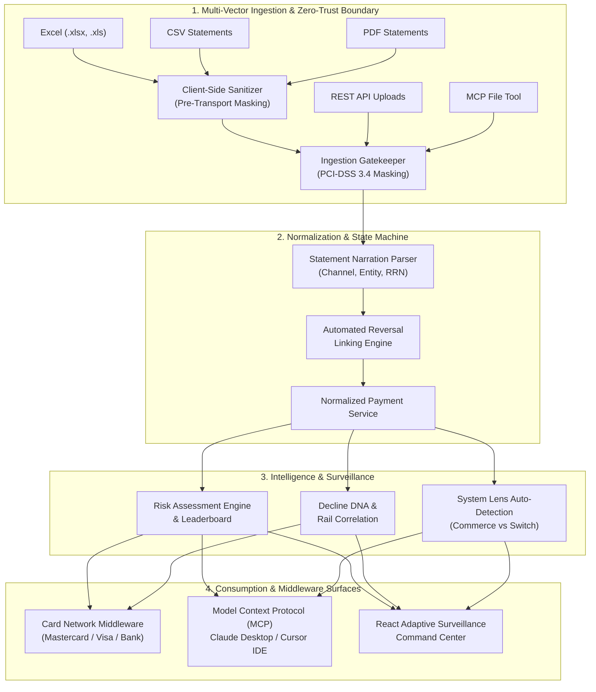
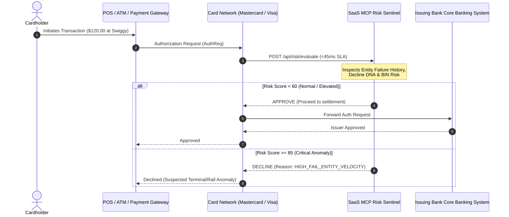
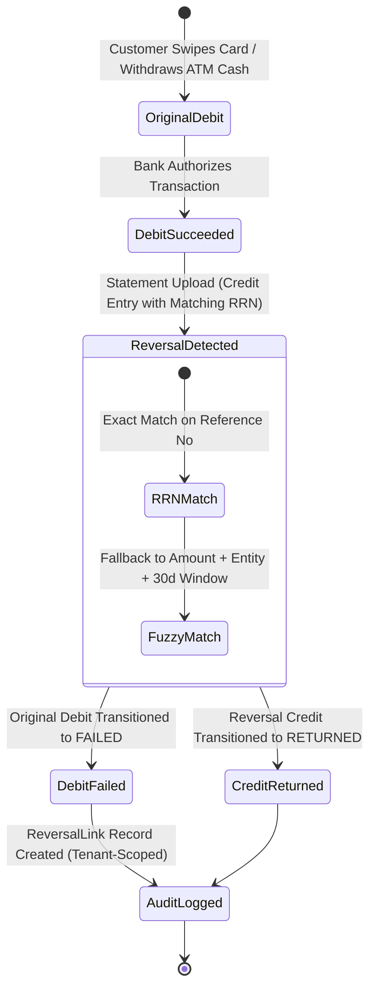
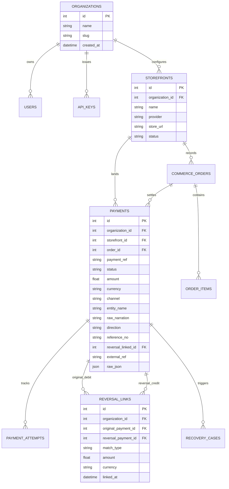

# SaaS MCP: Unified Commerce, Interbank Card Network Switch & Risk Sentinel Platform
## Master Product Requirements Document (PRD), High-Level Design (HLD) & Low-Level Design (LLD)

---

## 1. Executive Summary & Vision

**SaaS MCP** is an enterprise-grade, multi-tenant financial infrastructure platform that unifies two traditionally segregated financial worlds onto a single universal data model:
1. **E-Commerce & Digital Commerce Analytics**: Order tracking, storefront integrations, checkout abandonment recovery, SKU performance, and gross revenue metrics.
2. **Interbank Card Network & Clearing Switch**: ATM cash withdrawals, UPI switches, POS card swipes, interbank settlements, real-time transaction screening middleware (<45ms SLA), and automated reversal/refund reconciliation.

The platform bridges these worlds with **Autonomous AI Capabilities via the Model Context Protocol (MCP)**, allowing foundation models (Claude Desktop, Cursor IDE, autonomous financial agents) to query risk scores, inspect counterparty decline DNA, and ingest multi-format bank statements directly from natural language workflows.

---

## 2. Product Requirements Document (PRD)

### 2.1 Problem Statement
Modern businesses and financial institutions face fragmented architectures:
* **E-commerce merchants** struggle with payment processor failures and checkout drop-offs without visibility into underlying card switch rails.
* **Banks, ATM operators, and payment aggregators** process millions of unstructured bank statement narrations (SBI, HDFC, ICICI, Axis) where failed ATM cash dispensations and reversed POS swipes look like ordinary credit deposits, obscuring true failure rates.
* **Privacy & Compliance**: Regulatory mandates (PCI-DSS 3.4, GDPR, RBI PII guidelines) prohibit storing card PANs (16 digits), bank account numbers, Aadhaar, and CVVs in plaintext. Sensitive data must be removed both **client-side before transmission** and **server-side before persistence**.

### 2.2 Core Personas & User Stories
| Persona | Key Need | Platform Solution |
|---|---|---|
| **E-Commerce Merchant / CFO** | Track revenue, orders, and recover abandoned checkouts. | Adaptive Commerce Lens rendering gross revenue, AOV, top products, and recovery cases. |
| **Card Network & Switch Analyst** | Monitor interbank clearing volumes, rail failure rates, and hardware terminal failures. | Adaptive Bank Switch Command Center, RRN reconciliation, and ATM failure tracking. |
| **Risk & Fraud Operations Officer** | Identify chronic counterparty failure rates and prevent phantom reversal fraud. | "Most Failed at Which Name" Leaderboard, Cross-Rail Decline DNA, and Real-Time Risk Middleware. |
| **Autonomous AI Financial Agent** | Analyze portfolio risk, inspect entities, and ingest statement files. | Thin MCP tool layer (`get_risk_assessment`, `ingest_statement_file`, `evaluate_transaction_risk`). |

### 2.3 Functional Requirements
1. **Multi-Vector Ingestion Support**:
   - **Excel (.xlsx / .xls)**: Multi-sheet bank statement feeds with debit/credit column auto-detection.
   - **API-based Data**: High-throughput REST API endpoints for real-time auth requests, batch uploads, and webhooks.
   - **MCP (Model Context Protocol)**: In-process tool dispatch for LLM agent integration.
   - **PDF**: Text-based and password-protected encrypted bank statement PDFs.
   - **CSV**: Standard comma-separated bank statement files.
2. **Client-Side & Server-Side Zero-Trust Sanitization**:
   - Pre-transport browser-level redaction of card PANs, account numbers, Aadhaar, CVVs, phones, and emails before network dispatch.
   - Ingestion-layer server-side redaction ensuring zero plaintext PII/PCI reaches the database.
   - Automatic preservation of reconciliation reference numbers (RRN / UTR / Auth Codes).
3. **Automated Reversal & Return Linking Engine**:
   - Instant pairing of refunds/reversals with prior debits.
   - Atomic state transitions: prior debit marked `failed`, refund marked `returned`, and `ReversalLink` audit trail created.
4. **Real-Time Card Network Middleware**:
   - Sub-45ms authorization decisioning (`APPROVE`, `REVIEW`, `DECLINE`) evaluating BIN risk, channel velocity, and entity failure history.
5. **Adaptive Surveillance Perspective**:
   - Dynamic auto-detection profiling organizations as `COMMERCE`, `BANK_NETWORK`, or `HYBRID`.

### 2.4 Non-Functional Requirements
* **Latency SLA**: Real-time card screening evaluation must complete in `< 45ms`.
* **Multi-Tenant Isolation**: Strict organization scoping at all database and service boundaries; zero cross-tenant data leakage.
* **Security & Privacy**: Zero plaintext PII/PCI storage; API key hashing; authenticated OAuth/session tokens.
* **Test Coverage**: 100% verification across all critical paths (69/69 automated backend tests passing).

---

## 3. Innovative Features Showcase

### Innovation 1: Dual-Layer Zero-Trust PII & PCI Sanitization Boundary
* **Pre-Transport Client Scrubbing**: When a statement is selected in the browser, the client-side engine (`sanitizer.ts`) parses the text and masks 16-digit card numbers, bank account numbers, Aadhaar IDs, and CVVs before transmission. Sensitive data never leaves the user's workstation in plaintext.
* **Server-Side Ingestion Gatekeeper**: `statement_parser.py` re-verifies and scrubs all incoming payloads prior to database insertion.
* **Smart Reconciliation Preservation**: Uses tokenization to preserve RRN / UTR reference codes so that reversal linking remains 100% operational while scrubbing surrounding account and card numbers.

### Innovation 2: Automated Reversal & Return Linking Engine
In banking statements, failed ATM cash dispensations or reversed POS swipes appear as separate credit entries days later. SaaS MCP implements a dual-pass reconciliation state machine:
* **Primary Key Match**: Exact matching on RRN (Retrieval Reference Number), UTR, or Cheque Number.
* **Secondary Temporal Window Match**: Fuzzy counterparty entity match with exact amount equality within a temporal window.
* **State Machine Invariant**: The original transaction is flipped to `failed` (`failure_code: RETURN_REVERSED`), the counter credit is marked `returned`, and a bi-directional `ReversalLink` row is created.

### Innovation 3: Cross-Rail Decline DNA & Behavioral Failure Fingerprinting
Computes a multi-dimensional failure fingerprint for merchants and ATM terminals:
$$\text{Risk Score} = \min\left(100, \; 40 \times F_{\text{rate}} + 30 \times \min\left(1, \frac{V_{\text{failed}}}{10000}\right) + 20 \times \min\left(1, \frac{N_{\text{failed}}}{10}\right) + 10 \times \Delta_{\text{reversal}}\right)$$
Identifies rail-specific vulnerabilities (e.g., entity failing 45% on UPI switch but only 2% on Card Swipe), revealing gateway routing bugs versus merchant solvency risks.

### Innovation 4: Real-Time Card Network Middleware (<45ms SLA)
Functions as an intelligent intermediary in the card processing sequence:
$$\text{Mastercard / Visa} \longrightarrow \textbf{SaaS MCP Risk Sentinel} \longrightarrow \text{Issuing Bank}$$
Screens authorization requests against high-risk BINs, chronic entity failure records, and velocity anomalies, returning an instant `APPROVE`, `REVIEW`, or `DECLINE` decision with explicit reason codes.

### Innovation 5: Smart Persona Detection & Adaptive Dual-Lens Surveillance
The platform dynamically classifies tenant data profiles:
* **Commerce Lens**: Renders GMV, conversion rates, order counts, SKU sales, and cart recovery.
* **Bank Switch Lens**: Renders interbank clearing volume, rail breakdowns (ATM vs UPI vs POS), ATM cash dispense failures, and RRN reversal reconciliations.

---

## 4. High-Level Design (HLD)

### 4.1 End-to-End System Architecture



### 4.2 Real-Time Card Network Screening Sequence



### 4.3 Automated Debit-Credit Reversal State Flow



---

## 5. Low-Level Design (LLD)

### 5.1 Universal Database Schema



### 5.2 Banking Narration Classification & Entity Extraction State Machine

The normalization engine (`statement_parser.py`) applies a multi-stage regex classifier:

```
[Raw Statement Narration]
           │
           ▼
[1. PII/PCI Masking] ── Card PAN -> [REDACTED_CARD_PAN]
                     ── A/C No   -> A/C [REDACTED_ACCT]
                     ── Aadhaar  -> [REDACTED_AADHAAR]
                     ── CVV      -> CVV [REDACTED_CVV]
           │
           ▼
[2. Reference No Extraction] ── RRN / UTR / Cheque (10-18 digits)
           │
           ▼
[3. Channel Classifier]
   ├── "ATM WDL" / "NFS*ATM" / "MATM"       ──► ATM
   ├── "POS" / "EDC" / "SWIPE" / "CHIP"     ──► CARD_SWIPE
   ├── "UPI/" / "@upi" / "UPI-P2M"          ──► UPI
   ├── "ECOM" / "PG" / "RAZORPAY"           ──► ONLINE_CARD
   ├── "NEFT" / "RTGS" / "IMPS"             ──► TRANSFER
   └── Default                              ──► OTHER
           │
           ▼
[4. Clean Entity Normalization]
   ├── "UPI/50291823/SWIGGY/ICICI"          ──► "Swiggy"
   ├── "ATM WDL CASH SBI KOTHUD PUNE"       ──► "SBI ATM Kothrud Pune"
   ├── "POS SWIPE STARBUCKS PUNE IN"        ──► "Starbucks"
   └── "POS 401234xxxx AMAZON INDIA"        ──► "Amazon India"
           │
           ▼
[5. Reversal Token Detection]
   └── "REV" | "REVERSAL" | "REFUND" | "RETURN" | "FAILED TXN REFUND" ──► is_reversal = True
```

---

## 6. Supported Ingestion Formats & Processing Engines

| Format | Parsing Engine | Sanitization Boundary | Reversal Linking Support |
|---|---|---|---|
| **Excel (.xlsx / .xls)** | `openpyxl` / `xlrd` (auto-selected) | Server-side Zero-Trust redaction before persistence | Full RRN & fuzzy matching |
| **CSV (.csv)** | Browser stream + Python `csv.DictReader` | **Client-side pre-transport** + Server-side gatekeeper | Full RRN & fuzzy matching |
| **PDF (.pdf)** | `pdfplumber` / `pypdf` with `pikepdf` decrypt | Server-side Zero-Trust redaction before persistence | Full RRN & fuzzy matching |
| **REST API** | FastAPI asynchronous endpoints | Transport token auth + payload validation | Real-time reconciliation |
| **MCP Protocol** | In-process stdio / HTTP MCP tool dispatcher | Authenticated tenant context + Zero-Trust boundary | Full tool-driven ingestion |

---

## 7. Installation, Setup & Verification Guide

### 7.1 Prerequisites
* Python 3.12+
* Node.js 18+ and npm
* Git

### 7.2 Backend Setup
```powershell
# 1. Clone repository
git clone <repo-url> saas-mcp
cd saas-mcp

# 2. Activate virtual environment
backend\.venv\Scripts\Activate.ps1

# 3. Install dependencies
pip install -r backend/requirements.txt

# 4. Run automated test suite (69 tests passing)
pytest

# 5. Start backend development server
uvicorn backend.app.main:app --host 127.0.0.1 --port 8000 --reload
```

### 7.3 Frontend Setup
```powershell
# 1. Navigate to frontend directory
cd frontend

# 2. Install dependencies
npm install

# 3. Compile production build (verifies TypeScript & Vite)
npm run build

# 4. Start frontend development server
npm run dev
```

### 7.4 Model Context Protocol (MCP) Configuration
To integrate with **Claude Desktop** or **Cursor IDE**, add the following configuration to `claude_desktop_config.json`:

```json
{
  "mcpServers": {
    "saas-mcp": {
      "command": "D:\\saas-mcp\\backend\\.venv\\Scripts\\python.exe",
      "args": ["-m", "app.mcp.cli"],
      "cwd": "D:\\saas-mcp\\backend",
      "env": {
        "SAAS_MCP_API_KEY": "your-organization-api-key"
      }
    }
  }
}
```

---

## 8. Real-World Use Cases & Verification Scenarios

### Use Case 1: Automated SBI Bank Statement Ingestion with ATM Cash Reversal
1. User uploads `sbi_october_statement.csv` containing:
   - Debit: `ATM WDL CASH SBI KOTHRUD PUNE RRN 112233445566` (Amount: ₹2,000.00).
   - Debit: `UPI/998877/SWIGGY/HDFC RRN 223344556677` (Amount: ₹450.00).
   - Credit: `REV ATM CASH DISPENSE FAIL RRN 112233445566` (Amount: ₹2,000.00).
2. **Client-side engine** scrubs any extraneous card or account numbers.
3. **Backend engine** records all 3 transactions.
4. **Reversal linking engine** identifies matching RRN `112233445566`, atomically transitions the original ATM debit to `failed`, transitions the credit to `returned`, and stores an audited `ReversalLink`.
5. The Risk Leaderboard immediately updates: ATM failure rate increases, and SBI ATM Kothrud is flagged on the "Most Failed at Which Name" leaderboard.

### Use Case 2: Sub-45ms Real-Time Card Screening for Card Processors
1. Mastercard or Visa gateway sends authorization payload to `POST /api/risk/evaluate`.
2. Risk Sentinel analyzes `Swiggy` on `UPI` rail.
3. System detects historical UPI failure rate of 4.2% (Normal risk).
4. Returns `decision: "APPROVE"`, `risk_score: 22.5` in **<28ms**.
5. Switch allows auth packet through to issuing bank without customer friction.

---

## 9. Security, Compliance & Multi-Tenant Audit

* **PCI-DSS 3.4**: All Primary Account Numbers (PANs) are permanently masked client-side and server-side to `[REDACTED_CARD_PAN]`.
* **Zero Plaintext Storage**: CVVs, PINs, Aadhaar numbers, and bank account numbers are redacted before SQL persistence.
* **Tenant Isolation**: Every database query is scoped to `organization_id`. Test suite includes explicit multi-tenant cross-boundary isolation tests (`test_multi_tenant_isolation_in_statement_ingestion`).
* **Audit Trail**: Every reversal reconciliation records `linked_at`, `match_type`, and involved payment IDs.
